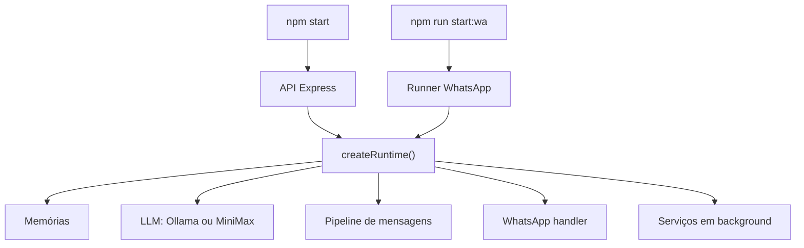
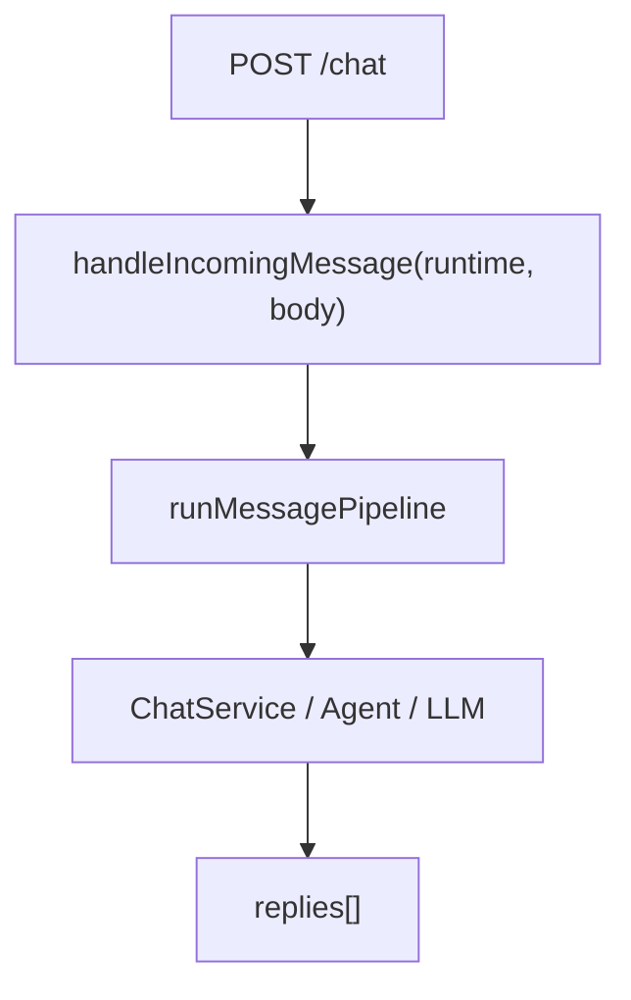
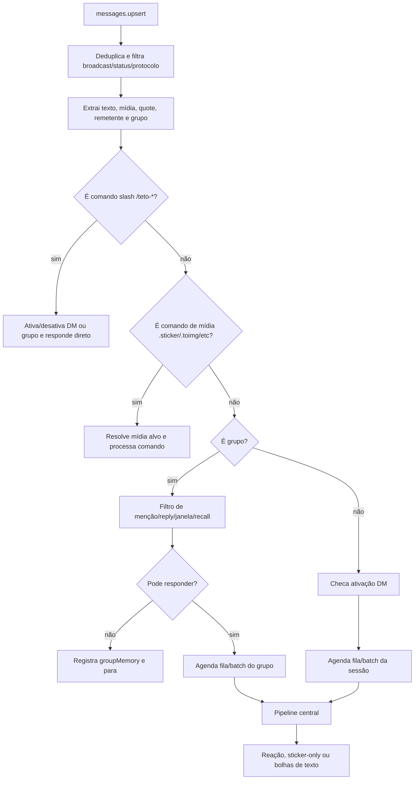
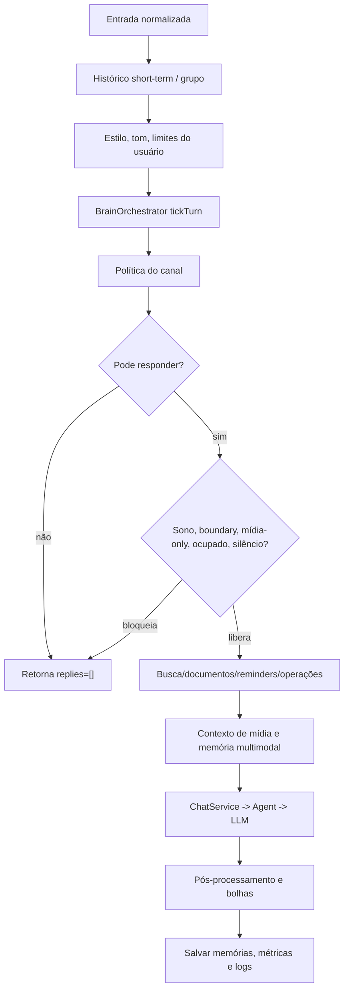

# TetOS - Arquitetura e Fluxos

Este documento mapeia como o programa roda, quais serviços ficam ativos em segundo plano e como ele reage a eventos como mensagens, comandos, mídia, grupos, reminders e chamadas pela API.

## Visão Geral

TetOS tem dois pontos principais de entrada:

- **API HTTP**: `src/infra/api/server.js`, iniciada por `npm start` ou `npm run start:api`.
- **Runner WhatsApp**: `src/integrations/whatsapp/runner.js`, iniciado por `npm run start:wa` (produção: `npm run start:wa:supervised`, que reinicia sozinho se cair).
- **Servidor MCP**: `src/integrations/mcp/tetoMcpServer.js` (`npm run mcp`), cliente fino da API para outros apps falarem com a Teto.

Ambos criam o mesmo runtime central:

- `src/app/createRuntime.js`

O runtime monta os módulos de memória, LLM, chat, cérebro/vida, canais, documentos, busca, reminders, observabilidade, mídia e WhatsApp.



## Mapa de pastas

```
src/
  app/createRuntime.js          monta tudo (memórias, LLM, vida, canais, mídia, integrações)
  core/
    agent/                      prompt da Teto (agent.js)
    brain/                      cérebro do turno, LLM clients, fase da conversa
    life/                       dayPlanner (plano do dia) + dailyLife (agora/sono/disponibilidade/humor)
    autonomy/                   initiative.js (quando ela puxa assunto) + ghostingPolicy
    memory/                     curto/longo prazo, peopleMemory (caderno por pessoa/grupo), grupo, episódica
    channels/ media/ social/ timing/ operations/ pipeline/ …
  integrations/
    whatsapp/
      runner.js                 entrada: conexão single/dual, reconexão, lock
      connection/               baileysClient, sonda de conexão, liveness
      inbound/                  messageHandler (recebe), contexto/quote, menções, digitação
      conversation/             orquestrador (fila, rajadas, envio), planejadores de grupo,
                                deferredInbox (respostas pra depois), outbox, presença online
      commands/                 comandos .sticker/.toimg…, downloads, ações de mídia do agente
      media/                    mídia recebida, repertório de figurinhas, view once
      loops/                    rotinas (lembretes, memória, outbox) + initiativeLoop
    automate/ automate-hub/     AutoMate (PC da dona) + ponte WhatsApp → AutoMate
    mcp/                        servidor MCP da Teto
    ui/                         app desktop
  modules/
    audio/                      transcrição (Whisper local em processo filho ou API compatível)
    voice/                      mensagem de voz (TTS) da Teto
    web/                        busca, leitura de links (YouTube/X/TikTok/Insta/páginas), clima
    chat/                       ChatService, parser de ações, styleRegulator (anti-flood/estilo)
    documents/ reminders/ vision/
  infra/                        API HTTP, config, fileStore, observabilidade
```

## Runtime Central

Arquivo: `src/app/createRuntime.js`

O runtime instancia:

- **Memória**: short-term, long-term, seletiva, episódica, grupo e multimodal.
- **LLM principal**: `OllamaClient` ou `MiniMaxClient`, conforme `TETOS_LLM_PROVIDER`.
- **Worker LLM opcional**: usado por vida/narração/resumos quando configurado.
- **ChatService**: chama o agente, pós-processa bolhas, evita eco e repara respostas ruins.
- **BrainOrchestrator**: emoção, vida, sono, timing, confiança, mundo, música, memória e autonomia.
- **ChannelRegistry**: decide se um canal está ativo, passivo, mutado ou bloqueado.
- **TetoActivationStore**: controla `/teto-ativar` e `/teto-grupo-ativar`.
- **SearchModule**: busca web.
- **DocumentModule**: leitura/escrita de documentos locais.
- **OperationRouter**: operações administrativas e confirmações.
- **ReminderStore/Scheduler**: armazenamento e varredura de reminders.
- **Logger/MetricsStore**: logs e métricas persistidas.
- **EventLedger/DailyReportGenerator**: aprendizado e relatórios diários.

## Contratos Arquiteturais

Estes arquivos sao tratados como contrato entre camadas. Ao alterar comportamento de fluxo, atualizar os testes e este documento junto.

| Contrato | Arquivo | Responsabilidade |
| --- | --- | --- |
| Modos de resposta | `src/core/pipeline/responseModes.js` | Nomes canonicos para `full`, `react_only`, `sticker_only`, `learn_only`, bloqueios e saidas (`text`, `reaction`, `sticker`, `silent`, `command`, `ignored`). |
| Identidade WhatsApp | `src/integrations/whatsapp/connection/whatsappIdentityContract.js` | Normaliza `remoteJid`, `userId`, `participantId`, `sessionId`, `channelId` e `channelScope`. |
| Trace de decisao | `src/infra/observability/decisionTrace.js` | Registra a trilha de decisao por evento: entrada, comando, gate de grupo, ativacao, modo do pipeline e saida. |
| Parser de comandos de midia | `src/integrations/whatsapp/commands/mediaCommandParser.js` | Decide se texto com prefixo e comando suportado e normaliza aliases como `.stiker`, `.otimizar`, `.remove-bg`. |
| Servico de comandos de midia | `src/integrations/whatsapp/commands/mediaCommandService.js` | Processa `.sticker`, `.fsticker`, `.csticker`, `.optimize`, `.removebg` e `.toimg` fora do fluxo conversacional. |

Regra pratica: handler de canal coleta contexto e decide gates de entrada; pipeline decide comportamento conversacional; servicos especializados executam comandos diretos sem chamar o LLM.

## Serviços que Rodam por Trás

### Sempre que o runtime sobe

O `BrainOrchestrator` cria um timer próprio quando `TETOS_BRAIN_ENABLED=true`:

- **Background brain tick**
  - Config: `TETOS_BRAIN_BACKGROUND_TICK_MS`.
  - Atualiza mundo, vida, social, música, corpo, saúde, emoção, repetição, confiança e memória.
  - Pode disparar pesquisa musical periódica.
  - Pode disparar evolução/autonomia e pensamentos solo.

### Quando o WhatsApp runner sobe

Arquivo: `src/integrations/whatsapp/runner.js`

O runner agenda loops auxiliares:

| Serviço | Config principal | O que faz |
| --- | --- | --- |
| Life tick | `TETOS_LIFE_TICK_MS` | Atualiza rotina/vida em intervalo maior. |
| Presence/nudges | `PRESENCE_ENABLED`, `PRESENCE_CHECK_MS` | Decide se a Teto deve puxar assunto com usuários conhecidos. |
| Reminder sweep | `TETOS_REMINDER_SWEEP_MS` | Procura reminders vencidos e tenta entregar no WhatsApp. |
| Daily report | `DAILY_REPORT_ENABLED`, `DAILY_REPORT_TIME` | Gera relatório diário quando chega o horário. |
| Media retention | `TETOS_MEDIA_RETENTION_ENABLED`, `TETOS_MEDIA_RETENTION_INTERVAL_MS` | Limpa/arquiva mídia antiga para controlar tamanho de `data/media`. |
| Mind-log retention | `TETOS_MIND_LOG_RETENTION_DAYS` | Remove mind logs antigos. |
| Inbound watchdog | `WHATSAPP_INBOUND_STALE_MS` | Opcional; reconecta se o socket parecer conectado mas não receber mensagens. |
| Reconnect WhatsApp | `WHATSAPP_AUTO_CONNECT` | Tenta reconectar após queda, exceto logout real. |

## Modos do WhatsApp

### Single

Config:

```env
WHATSAPP_MODE=single
```

Um único socket faz tudo:

- lê mensagens
- aprende
- responde
- processa comandos de mídia
- entrega reminders
- envia nudges

### Dual

Config:

```env
WHATSAPP_MODE=dual
WHATSAPP_MAIN_OBSERVE_ONLY=true
```

Dois sockets:

- **main**: número principal, observa chats e aprende.
- **media/bot**: número da Teto, responde chat e processa `.sticker`, `.toimg`, etc.

Se `WHATSAPP_MAIN_OBSERVE_ONLY=false`, o main também pode responder e o media fica mais focado em comandos de mídia.

## Fluxo da API HTTP

Arquivo: `src/infra/api/server.js`

### `POST /chat`



Esse caminho é parecido com uma mensagem normal, mas sem Baileys, sem fila de WhatsApp, sem typing e sem envio real para WhatsApp.

### Endpoints operacionais

- `POST /memory/save`, `POST /memory/delete`, `GET /memory`, `GET/POST /memory/search`.
- `POST /session/clear`.
- `GET /channels`, `GET /channels/:channelId`, `POST /channels/admin`.
- `POST /search`.
- `GET /documents`, `GET /documents/:id`, `POST /documents/:id`.
- `GET /reminders`.
- `GET /memory/multimodal`.
- `POST /operations`.
- `GET /logs`, `GET /metrics`, `GET /runtime/summary`, `GET /status`.

## Fluxo Geral de Mensagem no WhatsApp

Arquivo principal: `src/integrations/whatsapp/inbound/messageHandler.js`



## Etapas do Handler de WhatsApp

### 1. Recepção e filtros iniciais

O handler:

- ignora `status@broadcast` e broadcasts.
- ignora mensagens de protocolo sem conteúdo útil.
- deduplica mensagens por ID por alguns minutos.
- trata deleções/revokes para remover snapshots quando possível.
- extrai:
  - `remoteJid`
  - `isGroup`
  - `participantId`
  - `userId`
  - `sessionId`
  - texto
  - mídia
  - quote/reply
  - `pushName`

### 2. Identidade em DM e grupo

Em DM:

- `remoteJid` representa o usuário.
- `userId` costuma ser o telefone extraído.
- `sessionId` é ligado ao DM.

Em grupo:

- `remoteJid` é o ID do grupo.
- `participantId` identifica quem falou.
- `userId` é o participante.
- `sessionId` separa conversas por grupo + participante.
- O canal do grupo também tem memória própria.

O `ChannelRegistry` guarda participantes, JIDs, telefones quando disponíveis e modo do canal.

Contrato atual: a montagem de identidade deve passar por `buildWhatsappIdentitySnapshot()` sempre que uma decisao de fluxo for registrada. Isso evita misturar chat (`remoteJid`), pessoa (`userId`), fila (`sessionId`) e escopo de memoria (`channelScope`).

### 3. Comandos slash de ativação

Arquivo: `src/integrations/whatsapp/commands/tetoSlashCommands.js`

Comandos:

- `/teto-ativar`
- `/teto-desativar`
- `/teto-grupo-ativar`
- `/teto-grupo-desativar`

Fluxo:

1. O handler detecta comando com `/`.
2. `handleTetoSlashCommand()` valida se é DM ou grupo.
3. Atualiza `TetoActivationStore`.
4. Envia uma resposta curta direto pelo socket.
5. Não passa pelo pipeline normal de LLM.

### 4. Comandos de mídia

Prefixo padrão: `COMMAND_PREFIX=.`

Comandos:

- `.sticker`
- `.fsticker`
- `.csticker`
- `.optimize`
- `.removebg`
- `.toimg`
- `.help`

Fluxo:

1. `parseWhatsAppCommand()` em `mediaCommandParser.js` detecta o comando.
2. `.help` responde direto com a lista de comandos.
3. Para comandos de mídia, `MediaCommandService` chama `resolveCommandTarget()` e procura mídia:
   - na própria mensagem
   - no reply
   - no histórico recente do chat
4. `MediaProcessor` processa:
   - imagem/vídeo/GIF para sticker
   - sticker para imagem/GIF/vídeo
   - compressão de sticker
   - remoção de fundo
5. Envia resultado no WhatsApp.
6. Registra evento em `eventLedger`.
7. Não gera resposta conversacional pelo LLM.

Em modo dual, se o comando chega no número errado, o main pode ignorar ou responder o hint configurado por `WHATSAPP_STICKER_COMMANDS_DISABLED_HINT`.

Contrato atual: comandos de midia sao saida `command` no `decisionTrace` e nao entram em `runMessagePipeline()`.

### 5. Repertório de figurinhas

Arquivos:

- `src/integrations/whatsapp/media/stickerRepertoire.js`
- `src/integrations/whatsapp/media/stickerRepertoireModeStore.js`
- `data/stickers/catalog.json`

Fluxo:

1. Figurinhas recebidas podem ser salvas em `data/stickers/` com metadados no catálogo.
2. Com `modoRepertorio("on")` ativo para o usuário, figurinhas recebidas entram no repertório automaticamente.
3. Visão pode nomear figurinhas (`visionDescription`, `displayName`) ao salvar.
4. `formatRepertoireForPrompt()` injeta chaves recentes no prompt do agente.
5. O agente envia figurinhas do repertório com `sticker("chave")` na resposta.

Persistência:

- `TETOS_STICKERS_PATH` (padrão `./data/stickers`)
- `TETOS_STICKER_REPERTOIRE_MODE_PATH` (padrão `./data/stickerRepertoireMode.json`)

### 6. Comandos de ação do agente

Arquivos:

- `src/modules/chat/chatService.js` (`parseActionCommands`)
- `src/integrations/whatsapp/commands/agentMediaCommands.js`

Após o LLM responder, `ChatService` extrai comandos embutidos no texto:

- `reagir("❤️")` / `react("👍")` — reação à mensagem
- `sticker("chave")` — envia figurinha do repertório; segundo arg opcional faz quote
- `mensagem("texto")` / `message("texto", "msg_id")` — bolha com quote opcional
- `salvarSticker("message_id")` — salva figurinha no repertório (chave opcional)
- `modoRepertorio("on"|"off")` — liga/desliga auto-save de figurinhas recebidas
- equivalentes de mídia por message id: `toimg("msg_id")`, `removebg("msg_id")`, etc.

Esses comandos são executados pelo orchestrator do WhatsApp após a geração, sem passar pelo parser de comandos com prefixo `.`.

## Decisão: Mensagem é Comando ou Conversa?

Ordem prática:

1. Se começa com `/teto-...`, é comando de ativação.
2. Se começa com `COMMAND_PREFIX` e está na lista de mídia, é comando de mídia.
3. Se é mídia sem texto e sem comando:
   - salva/analisa mídia quando aplicável.
   - normalmente não responde se não for direcionada à Teto.
4. Caso contrário, é conversa e entra no fluxo de grupo/DM + pipeline.

## Fluxo em Grupo

Em grupo, o bot é mais conservador.

### Antes do pipeline

O handler avalia:

- mensagem menciona a Teto?
- é reply para mensagem da Teto?
- chama pelo nome de forma clara?
- existe janela de engajamento ativa?
- há recall/contexto da memória de grupo?
- grupo está ativado quando `TETOS_ACTIVATION_REQUIRED=true`?

Se não houver motivo para responder:

- a mensagem pode ser registrada em `groupMemory`.
- não gera LLM.
- não envia resposta.

### Janela de engajamento

Quando alguém menciona ou responde a Teto no grupo, `GroupEngagementWindow` mantém uma janela curta configurada por:

```env
TETOS_GROUP_ENGAGEMENT_MS=120000
```

Dentro dessa janela, o mesmo contexto pode receber resposta mesmo sem nova menção direta.

### Política de canal

Arquivo: `src/core/channels/channelRegistry.js`

Se o grupo tem muitos participantes, o canal pode entrar em modo `passive`.

No modo `passive`:

- responde se houver menção direta, reply ou janela ativa.
- responde a perguntas diretas em alguns casos.
- pode permitir `react_only` aleatório.
- caso contrário, ignora.

### Fila de grupo

Mensagens de grupo são agrupadas por canal:

- espera `TETOS_GROUP_BATCH_WINDOW_MS`.
- considera se alguém ainda está digitando.
- usa `planGroupTurnSegments()` para dividir turnos quando há múltiplos assuntos/quotes.
- processa em fila por grupo para evitar respostas atropeladas.

## Fluxo em DM

Em DM, o fluxo é mais direto:

1. Checa ativação se `TETOS_ACTIVATION_REQUIRED=true`.
2. Se o usuário for owner, pode autoativar DM.
3. Se não estiver ativo, responde instrução para `/teto-ativar` e para.
4. Se estiver ativo, agenda em fila por sessão.
5. Mensagens próximas podem ser fundidas em uma só entrada.
6. A entrada vai para o pipeline central.

## Fila, Batch e Interrupção

O `createConversationOrchestrator()` (`src/integrations/whatsapp/conversation/conversationOrchestrator.js`) organiza envio e geração.
Ele sobrevive a reconexões ("handler religado, mesma fila"): por isso todo envio passa por `waSocket()`/`sendRaw()`
e o serviço de mídia é obtido por getter — nunca pelo socket capturado na primeira conexão.

### Por que existe

- Evitar responder a cada bolha pequena imediatamente.
- Juntar mensagens consecutivas do usuário.
- Aguardar se o usuário ainda está digitando.
- Interromper resposta antiga se chegou mensagem nova.
- Evitar várias gerações simultâneas para a mesma sessão/grupo.

### Regras gerais

- DM usa `TETOS_BATCH_WINDOW_MS`.
- Grupo usa `TETOS_GROUP_BATCH_WINDOW_MS`.
- Se a fila cresce demais, mensagens são coalescidas até `TETOS_MAX_QUEUE_COALESCE`.
- Cada sessão tem fila própria.
- Grupo tem fila por canal.
- Antes de enviar bolhas, se chegou nova mensagem, o token de interrupção cancela o envio antigo.

## Pipeline Central de Mensagem

Arquivo: `src/core/pipeline/messagePipeline.js`



### O que o pipeline decide

O pipeline pode retornar sem resposta se:

- política de canal bloqueou.
- Teto está dormindo/indisponível.
- usuário impôs limite forte.
- mídia veio sozinha sem endereçamento.
- Teto está ocupada em foco alto.
- timing calculou silêncio apropriado em grupo.
- `REPLY_ENABLED=false`.
- socket main está em modo observe-only.

Os modos retornados pelo pipeline devem usar `RESPONSE_MODES`. Evitar strings soltas como `"react_only"` ou `"timing_silence"` fora de `responseModes.js`.

### Intenções internas

Antes de chamar o LLM, ele detecta e monta contexto para:

- busca web
- confirmação de operação pendente
- comandos naturais administrativos
- documento local
- reminder
- mídia atual
- memória multimodal recente
- lore musical, como Machine Love

### Reminders no pipeline

O usuário pode pedir para criar/listar/concluir reminders por linguagem natural.

O pipeline:

- detecta intenção com `detectReminderIntent()` (relativo: "daqui 10 min", "em meia hora", "1h30"; absoluto:
  "às 15h", "18:30", "amanhã às 9", "hoje à noite"; fuso `DAILY_REPORT_TZ`). "Você me lembra de…" não é pedido.
- pedido sem horário vira `needs_time`: a Teto pergunta quando — nada é criado sem `dueAt`.
- cria/lista/conclui no `ReminderStore`, gravando `chatJid` (chat onde foi pedido).
- passa um `reminderContext` para a resposta.
- a entrega do vencido é `deliverDueReminders()` (`src/modules/reminders/reminderDelivery.js`), chamada pelo loop do runner;
  o destino é `resolveReminderJid()` (chatJid; legado: `dm-<lid>` → `@lid`, telefone → `@s.whatsapp.net`).

### Operações administrativas

O pipeline detecta:

- comandos administrativos explícitos
- linguagem natural administrativa
- respostas de confirmação

Dependendo da operação, pode:

- executar direto
- pedir confirmação
- bloquear por falta de permissão
- mutar/bloquear canal sem gerar resposta longa

## BrainOrchestrator no Turno

Arquivo: `src/core/brain/BrainOrchestrator.js`

Em cada mensagem conversacional, `tickTurn()` monta:

- a vida dela agora (`DailyLife`: atividade, sono, humor/energia — derivados do plano do dia)
- confiança/intimidade com a pessoa
- memória de recuperação
- mídia atual
- fase da conversa
- plano de timing
- arbitragem de comportamento
- bloco `[SUA VIDA AGORA …]` (o que faz, fez, aconteceu, vem depois) + "fundo da cabeça" (vínculo, repetição, relacionamento)

O narrador por LLM e os sistemas antigos de rotina/NPC/corpo/mundo foram removidos: inventavam coisas que não
ficavam salvas, travavam (humor "irritada" e "com fome" pra sempre) e custavam uma chamada extra por mensagem.

O resultado influencia:

- se responde ou silencia
- delay de leitura/pensamento/digitação
- tom e contexto da resposta
- close decision: responder, reagir, silenciar ou despedida curta

## ChatService e Agent

Arquivo: `src/modules/chat/chatService.js`

O `ChatService`:

- aplica delay de pensamento.
- decide encerramento natural.
- chama `Agent.respond()`.
- divide resposta em bolhas via `ResponseProcessorPool`.
- evita eco do usuário.
- regenera quando detecta resposta cega ao contexto.
- evita drift/meta estranho.
- registra turno na short-term memory.
- retorna `replies[]`.

O envio final das bolhas é feito pelo WhatsApp orchestrator, não pelo `ChatService`.

## Saída: Texto, Reação ou Sticker

Depois do pipeline:

1. Se `replies[]` tem texto, o WhatsApp envia bolhas.
2. Se a decisão é `react` ou modo `react_only`, tenta reagir à mensagem.
3. Se modo passivo escolheu `sticker_only`, tenta enviar sticker local via `resolveStickerAsset("ack")` (fallback: `ok`, `thumbs_up`, `heart`).
4. Se o agente emitiu `sticker("chave")`, envia figurinha do repertório em `data/stickers/`.
5. Se não há texto nem ação passiva nem sticker do agente, fica em silêncio.

**Dois fluxos de figurinha:**

| Fluxo | Gatilho | Resolução de asset |
| --- | --- | --- |
| Passivo | `react_only` + chance configurada | `ack.webp` → `ok.webp` → `thumbs_up.webp` → `heart.webp` |
| Agente | `sticker("chave")` na resposta do LLM | `data/stickers/{chave}.webp` ou entrada em `catalog.json` |

Cada evento WhatsApp deve finalizar um `decisionTrace` com uma destas saidas:

- `text`: houve envio de bolha textual.
- `reaction`: houve reacao.
- `sticker`: houve sticker passivo.
- `silent`: o evento foi processado sem resposta.
- `command`: um comando direto foi executado.
- `ignored`: o evento foi descartado por filtro, gate ou duplicidade.

### Digitação e delays

No DM:

- simula `composing`.
- espera delay calculado pelo timing.
- pausa antes de enviar.
- divide múltiplas bolhas com intervalo.

No grupo:

- evita typing longo.
- usa delay menor/mais discreto.
- pode responder com quote.

## Mídia e Aprendizado Multimodal

Quando chega mídia:

- `mediaStore` persiste arquivo em `data/media`.
- áudio pode ser transcrito.
- imagem/vídeo/GIF pode receber análise visual.
- sticker entra como tipo de mídia.
- `MediaLearningHub` aprende afinidades.
- `multimodalMemory` salva mídia + mensagem.
- contexto recente pode entrar no prompt como `[RECENT MULTIMODAL MEMORY]`.

Se a mídia vier sem texto e sem endereçar a Teto, o sistema tende a aprender/guardar sem responder.

## Eventos de Grupo do WhatsApp

O runner também escuta:

- `chats.update`
- `groups.update`
- `group-participants.update`

Esses eventos:

- alimentam `eventLedger`.
- atualizam participantes no `ChannelRegistry`.
- ajudam o sistema a saber tamanho/modo do grupo.

## Estrutura do runner

| Arquivo | Responsabilidade |
| --- | --- |
| `runner.js` | Ciclo de vida da conexão (single/dual), reconexão, lock, sonda ativa, ponte `runtime.whatsappGetSocket`. |
| `loops/auxiliaryLoops.js` | Timers: vida, iniciativa, lembretes, consolidação de memória, caixa de saída, relatório, retenções. |
| `loops/initiativeLoop.js` | Iniciativa: `listKnownUsers()` + `runPresence()` usando `chooseInitiative()`. |
| `inbound/messageHandler.js` | Recepção, filtros, identidade, comandos, gates de ativação/grupo e **porta de disponibilidade**. |
| `conversation/conversationOrchestrator.js` | Fila/rajadas, digitação, geração, interrupção, regulador de estilo, envio e ações do agente. |
| `conversation/deferredInbox.js` | Mensagens guardadas enquanto ela dorme/está ocupada (em disco), entregues na hora certa. |
| `inbound/waHandlerUtils.js` | Utilitários compartilhados (logThinking, sleep, isWaConnectionError, extractPhone, applyVisionFields). |

## Identidade e JIDs (regras)

- Chave de identidade é **só ID**: telefone, LID, `dm-*` ou JID de pessoa (`isIdentityIdLike`). Apelido nunca é identidade —
  antes "oi"/"kkk" viravam chave e ligavam centenas de contatos entre si (e ~800 regravações de arquivo por mensagem).
- Busca por nome/apelido usa o índice de nomes (`buildIdentityIndex`).
- `<telefone>@lid` não existe (`isBogusLidJid`); o JID de PV vem de `resolveNudgeRemoteJid()`: dona → `TETOS_OWNER_WA_JID`,
  senão última sessão de PV vista, senão deduz pelo tipo do id (`dmJidForLocalId`).
- `repairProfileContamination()` roda no boot (idempotente, uma gravação); `npm run data:sanitize` faz a limpeza pesada
  (remove perfis-artefato, chaves lixo de time/userPatterns, lembretes sem horário) com backup.

## Persistência

- `writeJsonDeferred()` (fileStore) coalesce gravações dos stores quentes (memória, time, userPatterns): N mudanças → 1 escrita,
  atômica (tmp + rename), com flush em `exit`/`SIGINT`/`SIGTERM`.
- `readJson()` devolve cópia do padrão e não derruba o processo com JSON corrompido (move para `*.corrupt-<ts>`).
- Scripts de teste que sobem o runtime importam `scripts/isolatedData.js` primeiro: rodam num diretório temporário.

## Reconnect, Lock e Estabilidade

O runner:

- cria `.wa-runner.lock` para evitar dois runners simultâneos.
- tenta reconectar em quedas quando `WHATSAPP_AUTO_CONNECT=true`.
- não reconecta automaticamente se o WhatsApp fez logout real.
- pode detectar conflito quando outro processo/sessão substituiu a conexão.
- suprime logs muito ruidosos do Baileys.

## Estados Persistidos Importantes

| Arquivo/pasta | Uso |
| --- | --- |
| `data/session` | Sessão Baileys principal. |
| `data/session-media` | Sessão Baileys secundária em modo dual. |
| `data/memory.json` | Long-term memory e perfis. |
| `data/short-term` | Histórico recente por sessão. |
| `data/selectiveMemory.json` | Memória seletiva antes de promoção. |
| `data/groupMemory.ndjson` | Memória de grupos. |
| `data/episodicMemory.ndjson` | Episódios conversacionais. |
| `data/multimodalMemory.json` | Memória multimodal. |
| `data/media` | Arquivos recebidos e derivados. |
| `data/reminders.json` | Reminders. |
| `data/channels.json` | Estado de canais/grupos. |
| `data/tetoActivations.json` | Ativações DM/grupo. |
| `data/stickers/catalog.json` | Catálogo do repertório de figurinhas. |
| `data/stickerRepertoireMode.json` | Modo repertório por usuário. |
| `data/logs/tetos.log` | Logs estruturados. |
| `data/logs/runner-*.log` | Saída do runner sob o supervisor (7 dias; fora do git). |
| `data/people.json` | Caderno de memória por pessoa (PV) e por grupo + falas ainda não consolidadas. |
| `data/life/state.json` | Vida: acordadas no susto por noite, acordada temporária. |
| `data/life/inbox.json` | Mensagens guardadas pra responder depois (dormindo/ocupada/na rua). |
| `data/life/initiative.json` | Iniciativa: última vez, sem resposta, contagem do dia, motivos já usados. |
| `data/whatsapp-outbox.json` | Pedidos de envio vindos da API/MCP/AutoMate para o runner. |
| `data/models/` | Modelo Whisper local (baixado na 1ª vez; fora do git). |
| `data/metrics.json` | Métricas. |
| `data/mind-log` | Logs de mente/turnos. |
| `data/reports/daily` | Relatórios diários. |

## Reforma de outubro/2026 — como cada peça funciona

**Vida 24/7** (`core/life/dayPlanner.js`, `core/life/dailyLife.js`)
- O dia é gerado só a partir da data (PRNG com semente): acorda/dorme (fim de semana mais tarde), café, almoço,
  jantar, banho, trabalho (gravar cover, ensaiar, mixar, call com produtor), lazer, saídas com amigos do universo dela
  (Miku, Rin, Len, Luka, Neru, Momo, Defoko, Ted) e âncoras semanais (aula de canto na terça, rolê na sexta, live no sábado,
  almoço na casa do Ted no domingo). 1–3 acontecimentos por dia mexem no humor. Mesma data → mesmo dia em qualquer processo.
- `availability()` diz se dá pra responder agora: livre (na hora), ocupada (1–5 min pra dona, 3–14 pros outros),
  na rua (2–10 / 5–28 min), dormindo (só depois de acordar). Urgência/insistência encurta. `TETOS_LIFE_REALISM=light|off`.
- Dormindo: a dona insistindo ("acorda", CAPS, várias mensagens) a acorda grogue **só pro chat dela**, no máximo 2x por noite.

**Porta de disponibilidade** (`inbound/messageHandler.js` + `conversation/deferredInbox.js`)
- Se ela não está livre, a mensagem vai pra caixa (em disco) com a hora em que ela "pega o celular"; mensagens seguintes
  entram na mesma leva. Na hora, vira um turno só, com `[VOCÊ SÓ VIU AGORA]` (ou catch-up de sono) no prompt.
- Grupo: dormindo ou demorando > 15 min → não responde (o papo já seguiu).
- Presença: online só enquanto ela usa o zap (`presenceManager`), lido (tique azul) quando abre a conversa pra responder.

**Iniciativa** (`core/autonomy/initiative.js` + `loops/initiativeLoop.js`)
- Só com gente próxima (dona, parceria, intimidade alta), só livre e acordada, nunca duas sem resposta, limite diário,
  estado em disco. Motivos: aniversário, pendência vencida ("como foi a entrevista?"), bom dia, algo do dia dela, saudade.
- O motivo entra no prompt como impulso interno (não é gravado como fala da pessoa).

**Memória de gente** (`core/memory/peopleMemory.js`)
- Cada fala vai pro buffer do caderno (PV: da pessoa; grupo: do grupo). Quando a conversa esfria (12 min) o modelo
  auxiliar reescreve o caderno: resumo, fatos com importância, pendências com data, aniversários. Fatos miúdos somem com
  o tempo; importantes ficam. No prompt: `[MEMÓRIA — o que você lembra de …]`. Escopo nunca cruza (PV ≠ grupo).

**Conversa natural** (`modules/chat/styleRegulator.js`)
- Antes de enviar: no máximo 3 bolhas no PV / 2 no grupo (excesso vai junto), um trecho curto em CAPS por resposta (nenhum
  se a anterior gritou), `!!!` → `!!`, tira a interjeição que abriu as últimas respostas, remove bolha repetida.
  O histórico guarda a versão corrigida (a IA não aprende os vícios de si mesma).
- Grupo: chamadas quase simultâneas de várias pessoas viram um turno só; cada um aprende só com o que ELE disse.

**Áudio, links, voz, clima**
- Áudio recebido: Whisper local num processo filho (`modules/audio/whisperProcess.js`, modelo em `data/models`) ou API
  compatível com OpenAI (`TETOS_STT_API_KEY`, ex. Groq). Silêncio/alucinação viram "sem fala".
- Link: `modules/web/linkReader.js` abre YouTube (yt-dlp + legenda), X (fxtwitter + foto via visão), TikTok/Instagram,
  Spotify e páginas comuns → `[LINK — você abriu e viu]`. Só baixa se pedirem ("baixa", "mp3", "manda o vídeo").
- Voz: comando `audio("…")` → TTS (Edge, voz configurável) → ogg/opus como mensagem de voz, "gravando…" antes.
- Clima: `modules/web/weather.js` (Open-Meteo) quando perguntam do tempo.

**Integrações**
- MCP: `npm run mcp` expõe conversar, o que ela está fazendo, mandar WhatsApp, lembretes e memória (via API + token).
- AutoMate pelo zap (só PV da dona): `computador("…")` → API `POST /automate/whatsapp/run` → PC; o resultado volta pela
  caixa de saída e ela explica. Exige `TETOS_API_TOKEN` e o AutoMate aberto.

## Resumo das Decisões Mais Importantes

| Pergunta | Quem decide | Resultado |
| --- | --- | --- |
| É comando `/teto-*`? | `parseTetoSlashCommand()` | Executa ativação e para. |
| É comando `.sticker` etc.? | `parseWhatsAppCommand()` | Processa mídia e para. |
| Pode responder em grupo? | Handler + `ChannelRegistry` + `GroupEngagementWindow` | Responde, registra sem responder ou ignora. |
| DM está ativo? | `TetoActivationStore` | Libera ou bloqueia. |
| Deve responder ou silenciar? | `ChannelRegistry`, `BrainOrchestrator`, `ChatService` | Texto, reação, sticker ou silêncio. |
| Deve criar reminder? | `detectReminderIntent()` | Salva em `ReminderStore`. |
| Reminder vencido deve ser enviado? | `ReminderScheduler` + loop do runner | Envia WhatsApp ou registra falha. |
| Deve puxar assunto sozinho? | `InitiationEngine` + `BasicLoop` + presence loop | Envia iniciativa no DM. |
| Deve guardar memória? | Pipeline + MemoryOrchestrator | Atualiza long-term, medium-term, seletiva, episódica, grupo e multimodal. |

## Caminho Mental Para Debug

Quando algo não responde, verificar nesta ordem:

1. `WHATSAPP_ENABLED`, `REPLY_ENABLED` e conexão do runner.
2. Se `TETOS_ACTIVATION_REQUIRED=true`, conferir `/teto-ativar` ou `/teto-grupo-ativar`.
3. Em grupo, confirmar menção/reply/janela de engajamento.
4. Conferir `data/channels.json` para modo `blocked`, `muted` ou `passive`.
5. Ver `data/logs/tetos.log` por `pipeline.policy`, `pipeline.sleep_hold`, `pipeline.timing_silence`, `pipeline.observe_only`.
6. Conferir `/status` e `/runtime/summary`.
7. Se for comando de mídia, confirmar se havia mídia alvo e olhar eventos `command.media`.
8. Se for LLM, checar modelo, chave, timeout e logs de `whatsapp.model_timeout`.
9. Se figurinha do agente não saiu, conferir `data/stickers/catalog.json` e se o LLM emitiu `sticker("chave")`.

## Testes de Contrato

Os testes arquiteturais ficam em `tests/architecture` e rodam com:

```bash
npm run test:architecture
```

Eles cobrem:

- parser e aliases de comandos de midia (`mediaCommandParser.test.js`).
- constantes de modos/saidas e decisao passiva de canal (`responseModes.test.js`).
- criacao e finalizacao de `decisionTrace` (`decisionTrace.test.js`).
- protocolo de comandos de acao do agente (`actionCommands.test.js`).

`npm run test:all` tambem chama estes testes, mas depende da API local e do provedor LLM configurado para os testes de chat.
